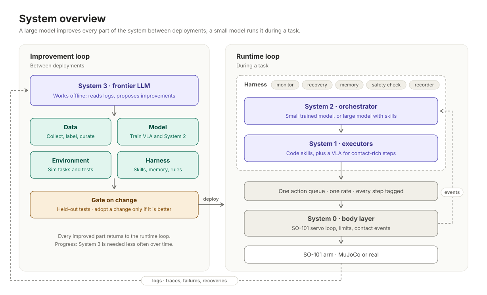

# Self-evolving robotic agent

Research code for a robotic agent system that improves over time and becomes reliable. A large model improves every part of the system between deployments: its data, models, simulation environment and harness. A small model runs the system during a task.

This work is currently part of a research course.



## The four layers

| Layer | Role |
|---|---|
| System 3 | A frontier LLM. Works offline: reads logs and proposes improvements, which pass a gate on change before they are deployed |
| System 2 | The orchestrator. Either a small trained model, or a large model that uses skills |
| System 1 | The executors: code skills, plus a vision-language-action (VLA) policy for contact-rich steps |
| System 0 | The body layer: the SO-101 servo loop, safety limits and contact events |

## Hardware and simulation

- Arm: SO-101, with Feetech STS3215 position servos.
- Simulator: MuJoCo.
- Robot learning stack: LeRobot.

## Status

Early. The first build stages are in progress: the simulation setup, one action queue for code skills and the VLA, and the first code skill.

## Install

```bash
uv sync --extra sim
```

Requires Python 3.12 and [uv](https://docs.astral.sh/uv/).
